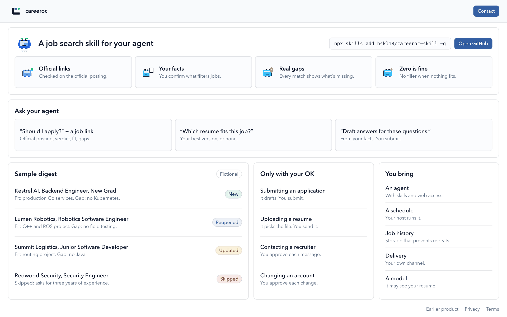

# careeroc

A job search skill for your agent.
It checks each job against the official posting, shows fit and gaps, and stays quiet when nothing qualifies.
It is in beta.

Website: https://www.careeroc.com



*[careeroc.com](https://www.careeroc.com) on 2026-11-08. The sample digest is fictional.*

## Install

```sh
npx skills add hskl18/careeroc-skill -g
```

`-g` installs it for your user instead of the current project, so it stays out of project repositories.
The installer asks which of your agents should get it.
To install by hand, copy `skills/careeroc` into your agent's skills folder, such as `~/.claude/skills/careeroc` or `~/.codex/skills/careeroc`.

## Update

```sh
npx skills update careeroc -g
```

The installer compares the installed files with this repository and replaces them when they differ, so edits made inside the installed skill folder are lost.
A hand-copied install updates only by copying again.
Each release is a tag listed under Releases, and `metadata.version` in `SKILL.md` names the version you have.

## Your profile

Copy [the example profile](skills/careeroc/assets/example-profile.md) outside the skill folder and replace it with your own facts.
Put your own rules, such as whether your agent may fill in application forms, under "Rules for your agent" instead of editing the skill, so updates never overwrite them.
[The example output](skills/careeroc/assets/example-output.md) shows what a single-role answer, a dry run, and an application question look like.

## Ask your agent

| You say | You get |
| --- | --- |
| "Should I apply?" and a job link | The official posting, a verdict, fit, and gaps |
| "Which resume fits this job?" | Your best existing version, or none |
| "Draft answers for these questions." | First-person drafts from your confirmed facts, for you to submit |

## What you get and what you bring

| Part | Status |
| --- | --- |
| Single-role verdicts, resume choice, application drafts | Works with an agent that has web access |
| Discovery and dry runs over your declared sources | Works; your agent fetches within the budgets you set |
| Scheduling | You bring it, such as your agent's scheduled tasks |
| Job history that prevents repeats within a year | A contract in [management.md](skills/careeroc/references/management.md); you bring the storage |
| Delivery that sends each job once | The same contract; you bring the channel |

Without web access, postings are marked unverified.
It never submits applications, uploads files to employers, or contacts anyone without your approval.
Your agent's model sees what you give it, including your resume.

## License

[MIT](LICENSE)
